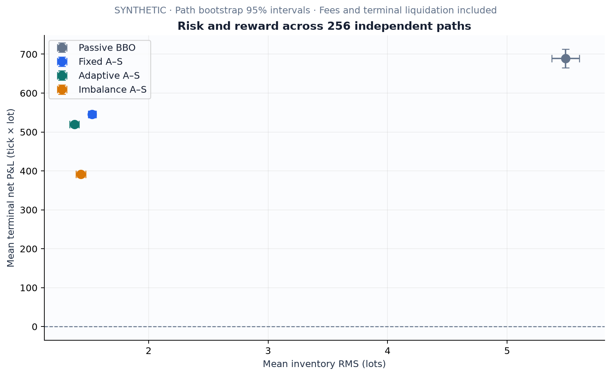
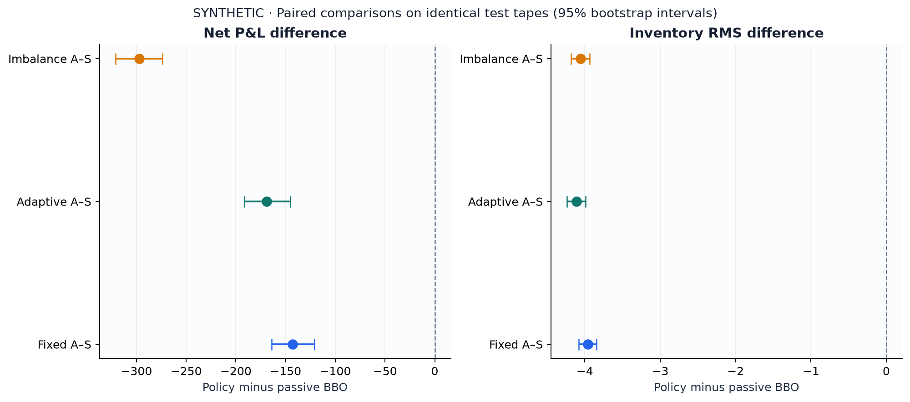
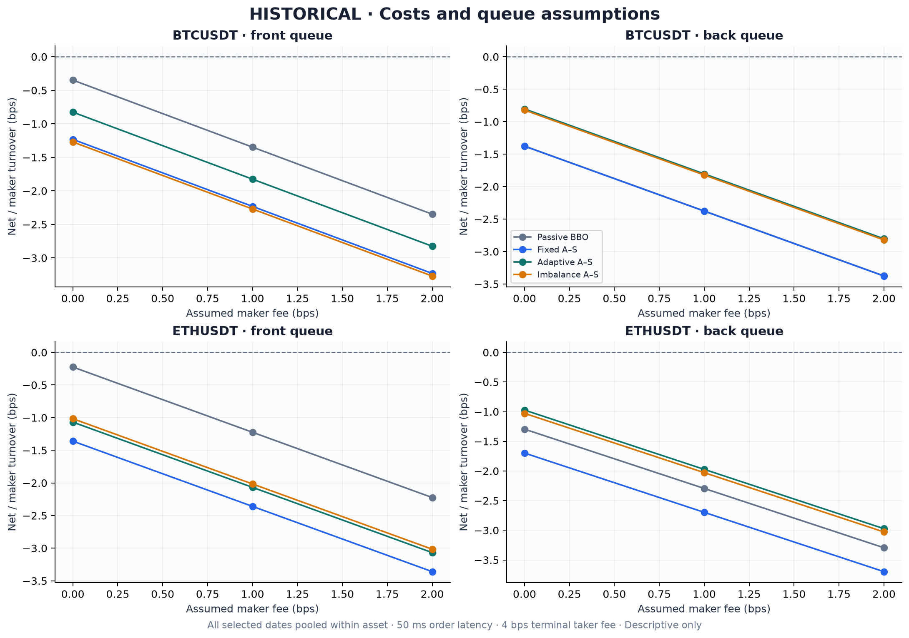

# When Does Market Making Pay After Costs and Inventory Risk?

**An execution-aware study of inventory control, trading costs, and the limits of backtests.**

An original Python research implementation of Avellaneda–Stoikov market making with causal calibration, delayed order replacement, volume-constrained partial fills, explicit queue assumptions, and auditable accounting. It combines a controlled Monte Carlo study with recorded ETHUSDT/BTCUSDT quote-and-trade replay.

**The main result is a trade-off:** adaptive inventory control reduces inventory exposure sharply, but does not beat passive quoting on raw profit in the controlled experiment. Historical results make the cost and queue assumptions visible rather than treating a favorable fill model as proof of an edge.

[Research report](results/RESULTS.md) · [Mathematical methodology](docs/METHODOLOGY.md) · [Executable notebook](notebooks/research_walkthrough.ipynb) · [Experiment protocol](docs/EXPERIMENT_PROTOCOL.md) · [Data provenance](docs/DATA.md) · [Validation](docs/VALIDATION.md)



## What the research contains

| Component | Implementation and evidence |
|---|---|
| Four policies | Passive BBO, fixed A–S, causal EWMA A–S, and an imbalance-skew extension |
| Calibration | Training-only volatility and exposure-adjusted Poisson composite likelihood, retaining zero-count depth bins |
| Execution | Delayed cancel/replace, old-order exposure during latency, post-only rejection, retained same-price priority, partial fills, integer lots, participation limits |
| Accounting | Self-financing cash, hard inventory caps, maker fees/rebates, forced closing spread and taker fee, P&L decomposition |
| Controlled evaluation | 256 independent held-out paths; paired bootstrap intervals; 36 queue × latency × cost × adverse-selection scenarios |
| Historical evaluation | Two instruments, three declared dates, normal and crash windows, genuine quote/trade archives with full SHA-256 verification |
| Research diagnostics | Policy-ranking surface, calibration fit, risk–reward frontier, conditional fee break-even and explicit inventory-risk preferences |
| Reproducibility | Seeded CLI, raw trial tables, source/configuration manifests, offline tests, CI, notebook, PNG/SVG figures |

The full synthetic study evaluates **5,632 policy runs**. The historical design adds **1,728 policy × block × execution-scenario runs** on **12,158,306 recorded events** across six asset-date samples. These counts do **not** imply thousands of independent historical observations.

## Measured synthetic findings

Reference scenario: back-queue proxy, 50 ms order latency, zero maker fee, and a 1 bp terminal closing fee. The later robustness grid varies costs instead of presenting this one scenario as universal.

| Policy | Mean net P&L, tick × lot | Mean inventory RMS, lots | Mean max drawdown, tick × lot |
|---|---:|---:|---:|
| Passive BBO | 688.69 | 5.489 | 125.46 |
| Fixed A–S | 545.72 | 1.527 | 31.48 |
| Adaptive A–S | 519.50 | 1.378 | 23.47 |
| Imbalance A–S | 391.27 | 1.432 | 27.86 |

Adaptive A–S lowers average inventory RMS by **74.9%**, at a mean P&L difference of **−169.18 tick–lots** versus passive BBO (paired 95% interval **[−191.44, −145.48]**). The imbalance heuristic does not improve this trade-off; the exposed imbalance is unvalidated and nonpredictive of next-interval flow in this generator, so this outcome should not be generalized to trained microprice signals. Every policy remains in the report.

Passive BBO ranks first in mean synthetic P&L in all 36 declared stress scenarios; fixed versus adaptive rankings can change with costs. The model's success is not defined as making the most elaborate strategy win.



## Run it

Python 3.10+ is supported; the recorded research run uses Python 3.12. All default tests and synthetic experiments are offline.

```bash
python -m venv .venv
source .venv/bin/activate
python -m pip install -e ".[dev]"

python -m pytest
mm-lab research --quick --output results/smoke
```

The full controlled experiment is intentionally small enough for a laptop:

```bash
mm-lab research --output results
mm-lab figures --output results
mm-lab report --output results
```

The recorded data experiment explicitly accesses the public archive provider. It streams complete archives to verify checksums, then keeps compact local windows. Raw archives and normalized data caches are Git-ignored. Stress-day archives can be large, so network reproduction takes longer than simulation.

```bash
mm-lab historical --output results --cache data/cache
mm-lab figures --output results
mm-lab report --output results
python scripts/verify_results.py
```

For a smaller network run:

```bash
mm-lab historical --days 2024-01-01 --symbols ETHUSDT \
  --seconds 2700 --output results/one-window --cache data/cache
```

The historical defaults are January 1/2, 2024 at 00:00–02:00 UTC and January 3 at 11:00–13:00 UTC. Each first 30 minutes is calibration; only subsequent blocks contribute performance. The stress date was selected from external event evidence before its strategy results were computed. The [protocol amendment](docs/EXPERIMENT_PROTOCOL.md) records an unavailable originally proposed archive and the replacement date.

`requirements-lock.txt` records the core package versions used for this run. `pyproject.toml` specifies portable dependency floors; use a fresh environment for comparisons across dependency versions.

## Read one execution

```python
from microstructure_mm.synthetic import generate, SyntheticConfig
from microstructure_mm.calibration import calibrate
from microstructure_mm.engine import replay

path = generate(seed=73, config=SyntheticConfig(duration=120))
parameters, diagnostics = calibrate(path.window(0, 30))
result = replay(path.window(30, 120), "as_adaptive", parameters)

print(result.summary)
print(result.fills.head())
```

Each recorded fill includes its trade timestamp, order submission and activation times, execution price and size, fee, post-fill inventory, and cash. Matching occurs before the strategy can react to an incoming event. A new order cannot fill on the event that triggered it.

## Historical evidence and its boundaries



Under the back-queue / 50 ms reference assumptions, **all 24 asset-date-policy totals are negative** after a 1 bp maker fee and 4 bps terminal taker fee. These are scenario assumptions, not an asserted exchange fee tier.

The [empirical tables](results/historical_blocks.csv) retain every selected asset-date, policy, queue, latency, and fee combination. [Fee break-even values](results/historical_break_even.csv) express exactly how much maker cost the recorded fill path can absorb after closing costs. A negative value requires a rebate even within this stylized simulator.

The input is top-of-book and aggregate trades, **not an identified order-level queue**. Front/back queue placements are assumptions, not guaranteed economic bounds. The model does not alter the market tape, estimates deep-order queue from a BBO proxy, assumes immediate feed observation, and uses final BBO liquidation with depth-overrun flags. The few dates and correlated intraday blocks support descriptive stress evidence, not a persistent-alpha claim or annualized Sharpe estimate.

## Repository map

```text
src/microstructure_mm/
  types.py          Event, tape, configuration and calibration contracts
  policies.py       Quoting policies and passive price constraints
  calibration.py    Causal variance and count-likelihood estimation
  engine.py         Delayed execution, queue, risk and accounting
  synthetic.py      Regime-switching marked-event stress generator
  data.py           Streaming archive integrity and normalized CSV adapters
  statistics.py     Paired path bootstrap and scenario rankings
  experiments.py    Declared synthetic and historical studies
  plots.py          Figures generated from saved tables
  report.py         Research report generated from saved results
  cli.py            Reproducible command-line interface
tests/              Hand-checkable accounting, causality and ingestion cases
docs/               Methods, protocol, data dictionary and reviewer guide
notebooks/          Executed research walkthrough
results/            Actual trial tables, manifests, report and figures
```

The tests cover same-event look-ahead, latency eligibility, queue depletion, partial volume, no cancellation credit, priority preservation, stale post-only rejection, fee identities, risk limits, forced liquidation, timestamp regressions, and full-archive integrity. CI also executes a small research run; it does not silently download market data.

## Attribution and scope of originality

The quoting foundation is [Avellaneda and Stoikov (2008)](https://math.nyu.edu/inmemoriam/avellaneda/HighFrequencyTrading.pdf).

This repository's contribution is an independently implemented and tested experimental framework, with explicit failure analysis and cost/risk diagnostics. The underlying model and standard statistical methods are established work; no universal novelty or superiority claim is made. All published numerical outcomes come from executed experiments.

Original code and synthetic work: [MIT](LICENSE). Historical-data-derived artifacts: [Binance Vision attribution and CC BY-NC-SA 4.0](LICENSE-DATA.md).
