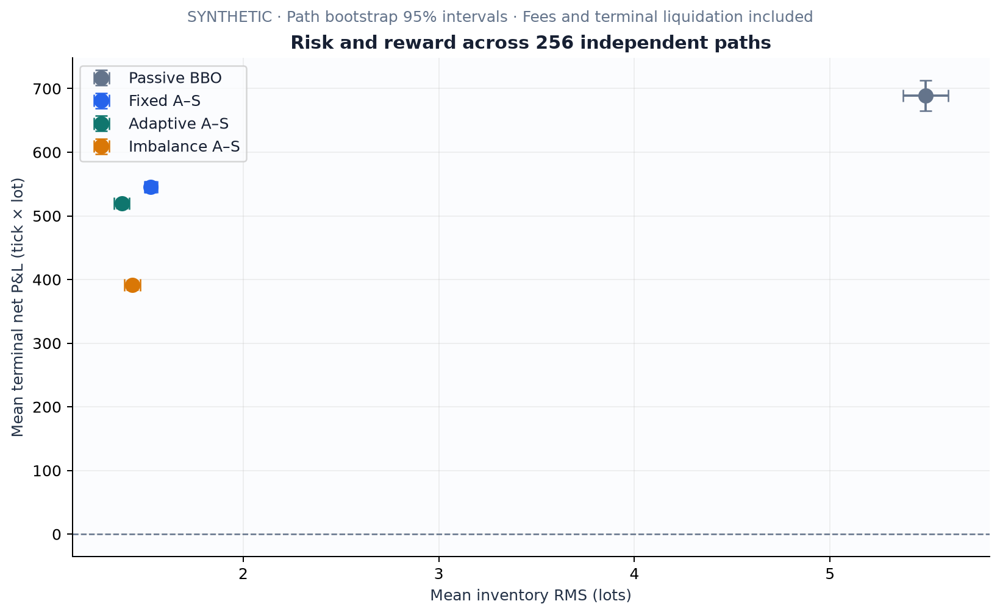
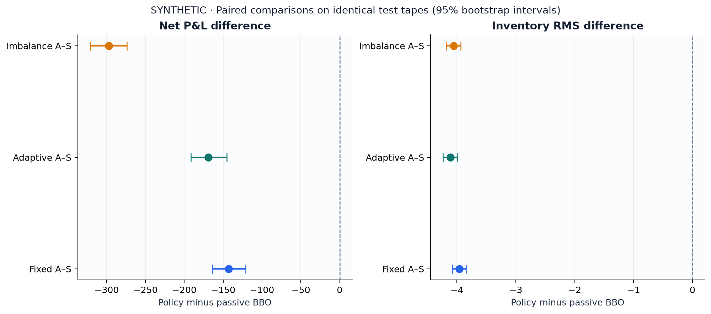
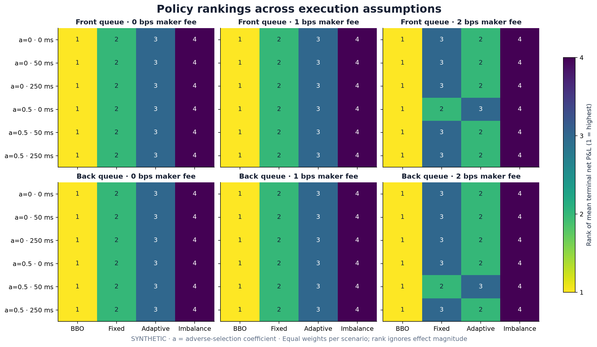
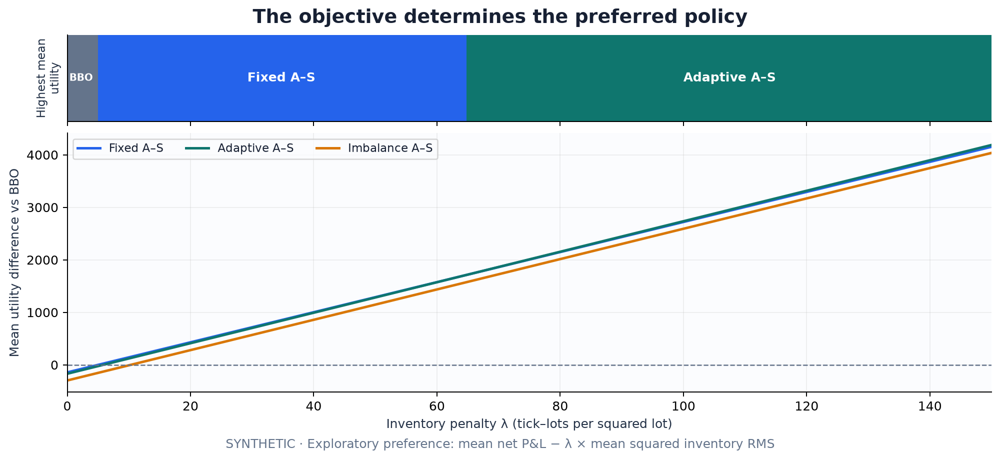
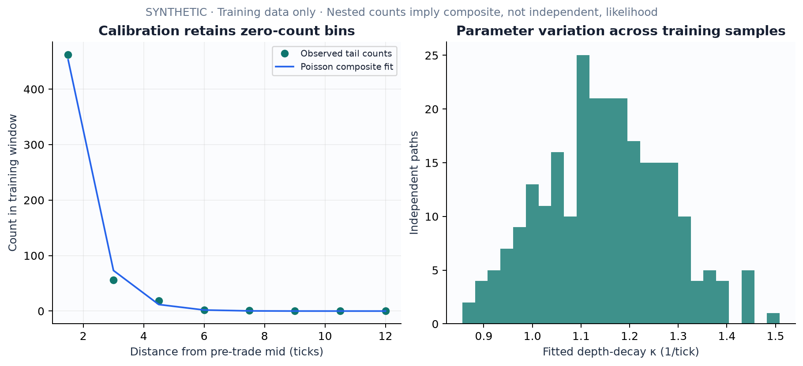
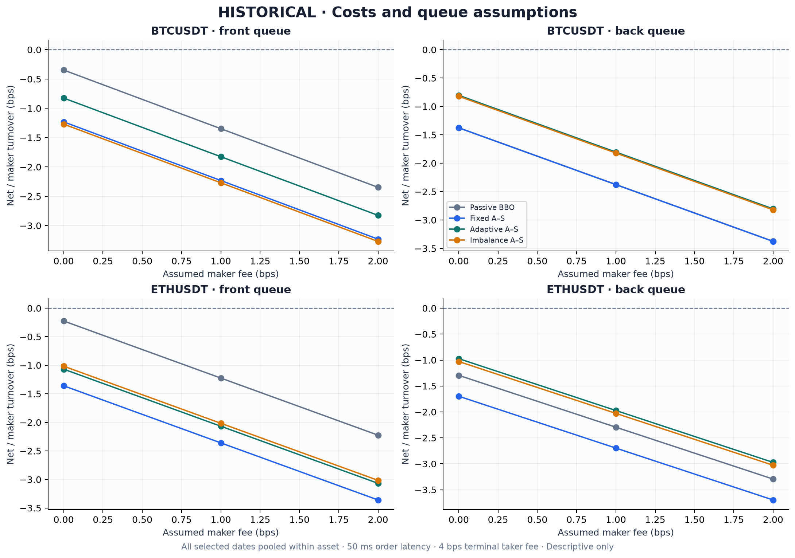
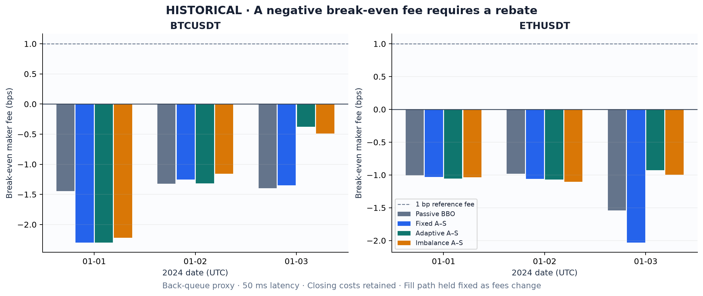

# Research results

These tables were generated from the committed CSV files. They distinguish independent simulated experiments from a small descriptive historical case study. See the [protocol](../docs/EXPERIMENT_PROTOCOL.md), [methodology](../docs/METHODOLOGY.md), and [run manifest](manifest.json).

## Main finding

Inventory control has a measurable price. Across **256 independent held-out synthetic paths**, adaptive A–S reduced average inventory RMS by **74.9%** relative to passive BBO, while changing mean net P&L by **-169.18 tick–lots** (paired 95% interval **[-191.44, -145.48]**). The extension is therefore not described as a raw-profit improvement. The synthetic imbalance feature is lagged and nonpredictive of subsequent flow; its failure is a negative-control-style result, not evidence against trained predictive microprice signals.

| Policy | Mean net P&L | 95% mean interval | Mean inventory RMS | Mean max drawdown |
| --- | --- | --- | --- | --- |
| Passive BBO | 688.69 | [665.31, 712.63] | 5.489 | 125.46 |
| Fixed A–S | 545.72 | [537.15, 554.47] | 1.527 | 31.48 |
| Adaptive A–S | 519.50 | [512.17, 526.75] | 1.378 | 23.47 |
| Imbalance A–S | 391.27 | [383.94, 398.43] | 1.432 | 27.86 |

P&L and drawdown are tick × lot; inventory is lots. The primary reference scenario has a back-queue proxy, 50 ms order latency, zero maker fee and 1 bp terminal taker fee. Every endpoint includes closing spread and liquidation fee. Intervals resample independent paths, not fills. This generator is not calibrated to a particular exchange.

## Paired evidence

| Policy | P&L difference vs BBO | Paired 95% interval | Fraction of paths with higher P&L |
| --- | --- | --- | --- |
| Adaptive A–S | -169.18 | [-191.44, -145.48] | 16.0% |
| Fixed A–S | -142.97 | [-164.17, -121.19] | 19.1% |
| Imbalance A–S | -297.42 | [-321.20, -274.09] | 5.5% |

## Execution-assumption surface

The factorial grid contains **36 scenarios**, each with **32 independent paths** paired across four policies. The highest mean-P&L counts are **Passive BBO: 36**. A cell rank alone says nothing about significance or effect size; the raw trials and paired intervals are also provided. In this experiment the leading raw-profit policy is stable, while fixed/adaptive relative rankings can change with costs.

The grid varies front/back queue placement, 0/50/250 ms order latency, 0/1/2 bps maker cost, and 0/0.5 tick signed-flow adverse selection. A positive synthetic mean in a low-cost cell is not an estimate of achievable market returns. The complete grid is in [stress_trials.csv](stress_trials.csv), with paired effects in [stress_paired_comparisons.csv](stress_paired_comparisons.csv).

## Exploratory economic preference calculation

Define a preference score $J_\lambda=E[P]-\lambda E[R]$, where $P$ is terminal net P&L and $R=q_{\mathrm{RMS}}^2$ is squared inventory RMS on each path. The risk-penalty level where a candidate matches passive BBO in the estimated means is $(\bar P_{BBO}-\bar P_j)/(\bar R_{BBO}-\bar R_j)$.

| Policy | Break-even inventory penalty λ |
| --- | --- |
| Fixed A–S | 4.993 |
| Adaptive A–S | 5.826 |
| Imbalance A–S | 10.295 |

The units of λ are tick–lots per squared lot. These are descriptive preference thresholds on the same simulated sample, not a new policy selected and independently validated afterward. The calculation makes the choice of economic objective explicit.

## Calibration and reproducibility

Training estimates, optimizer diagnostics, and zero-count tail bins are retained. The exposure-adjusted count objective is a composite likelihood because thresholds overlap. No naive Hessian-based inference is claimed. Core source digest: `c1b49f8eb4b29d788733c357cdbd84628d604744f4689225c55c7239cb61159a`. The saved synthetic run contains **5,632 policy evaluations** and took **45.6 seconds** on the environment recorded in the manifest; runtime is machine dependent.

## Historical case study

**12,158,306 recorded events** across **6 asset-date windows**, evaluated as **1,728 policy × block × execution-scenario runs**. The reference execution scenario below assumes back queue, 50 ms order latency, 1 bp maker cost and 4 bps terminal taker cost. **0 of 24 asset-date-policy totals are positive** under those assumptions. This is a report of the tested sample, not a claim of a persistent trading edge.

| Asset | Date | Policy | Net P&L (USDT) | Net / maker turnover (bps) | Maker fill events |
| --- | --- | --- | --- | --- | --- |
| BTCUSDT | 2024-01-01 | Adaptive A–S | -5.3107 | -3.30 | 378 |
| BTCUSDT | 2024-01-01 | Fixed A–S | -5.1691 | -3.30 | 368 |
| BTCUSDT | 2024-01-01 | Imbalance A–S | -5.3483 | -3.22 | 390 |
| BTCUSDT | 2024-01-01 | Passive BBO | -7.5741 | -2.44 | 728 |
| BTCUSDT | 2024-01-02 | Adaptive A–S | -18.3350 | -2.32 | 1759 |
| BTCUSDT | 2024-01-02 | Fixed A–S | -17.8803 | -2.25 | 1765 |
| BTCUSDT | 2024-01-02 | Imbalance A–S | -17.5441 | -2.16 | 1807 |
| BTCUSDT | 2024-01-02 | Passive BBO | -27.8836 | -2.32 | 2667 |
| BTCUSDT | 2024-01-03 | Adaptive A–S | -21.0556 | -1.38 | 3554 |
| BTCUSDT | 2024-01-03 | Fixed A–S | -36.3213 | -2.35 | 3602 |
| BTCUSDT | 2024-01-03 | Imbalance A–S | -22.9472 | -1.49 | 3583 |
| BTCUSDT | 2024-01-03 | Passive BBO | -42.4094 | -2.40 | 4112 |
| ETHUSDT | 2024-01-01 | Adaptive A–S | -1.8863 | -2.06 | 416 |
| ETHUSDT | 2024-01-01 | Fixed A–S | -1.8670 | -2.03 | 413 |
| ETHUSDT | 2024-01-01 | Imbalance A–S | -1.8416 | -2.04 | 405 |
| ETHUSDT | 2024-01-01 | Passive BBO | -4.0560 | -2.01 | 941 |
| ETHUSDT | 2024-01-02 | Adaptive A–S | -6.7766 | -2.07 | 1449 |
| ETHUSDT | 2024-01-02 | Fixed A–S | -6.7571 | -2.06 | 1453 |
| ETHUSDT | 2024-01-02 | Imbalance A–S | -6.9753 | -2.10 | 1459 |
| ETHUSDT | 2024-01-02 | Passive BBO | -10.8394 | -1.98 | 2451 |
| ETHUSDT | 2024-01-03 | Adaptive A–S | -15.7557 | -1.93 | 3909 |
| ETHUSDT | 2024-01-03 | Fixed A–S | -24.8370 | -3.03 | 3901 |
| ETHUSDT | 2024-01-03 | Imbalance A–S | -16.4574 | -2.00 | 3951 |
| ETHUSDT | 2024-01-03 | Passive BBO | -23.8292 | -2.54 | 4495 |

Order sizes are 0.01 ETH or 0.001 BTC; position limits are 0.1 ETH or 0.01 BTC. All strategies use identical sizes within an asset. Each 15-minute block starts and ends flat. The six contiguous blocks per asset-date are dependent. No IID confidence interval is assigned to these empirical totals.

### Conditional maker-fee break-even

The exact conditional threshold is $f^*=10^4 P_0/N$, where $P_0$ is net P&L at zero maker fee (still including closing costs) and $N$ is maker turnover. Changing the fee does not change quotes or fills in this model, so $P(f)=P_0-fN/10^4$. A negative threshold means a rebate would be required to break even even before considering additional omitted costs. This is not an estimate of an actual exchange's fee tier.

[historical_break_even.csv](historical_break_even.csv) reports every asset-date, policy, queue and latency case. The model does not turn thousands of correlated fills into thousands of independent observations.

Historical figures and values are derived from Binance Vision data and distributed under [CC BY-NC-SA 4.0](../LICENSE-DATA.md). Their exact source URLs, full-archive SHA-256 checksums, scan counts, time windows and normalized-cache checksums are in [data_provenance.json](data_provenance.json). No raw exchange archive is included in the repository.

## Limits and what would change the conclusion

The replay cannot identify actual order-level queue position, reactively alter market impact, or model a complete live feed/gateway latency chain. The same-price priority rule and unknown deep-book depth are assumptions. Terminal flattening uses the last BBO and records any visible-depth overrun. Synthetic uncertainty is conditional on the chosen generator; historical coverage remains a few short windows. All four policies, all declared stress cells, and all selected dates are retained.

The next meaningful test is a frozen multiweek evaluation with order-level data, independently observed execution latency, and a prospectively chosen capital/risk objective. More elaborate policy names or a favorable single chart would not supply that evidence.
